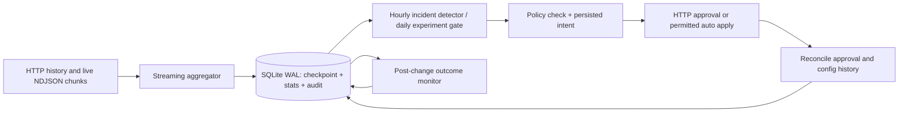

# Outcome-First Agent Loop — Submission

**Name:** Pravek Yadav · **Date:** 2026-11-08 · **Hours actually spent:** not precisely tracked across the interrupted sessions · **Language / storage:** Python, httpx, SQLite WAL

## 0. TL;DR

The controller streams event chunks into transactional aggregates, detects caller-ID and hallucination incidents, runs cautious workflow-level experiments, and routes changes through the simulator's governance API. The original public_01 run graded at +2.4% aggregate conclusion-rate lift; an earlier public_02 run graded at +4.2% but missed the prompt incident. The corrected public_02 run finished, but its grader could not be executed in the restricted terminal environment. Cohort optimization, call-time tuning, and automatic rollback were deferred.

## 1. Assumptions

1. The HTTP API is the sole source of operational truth. The controller never reads `sim/`, scenario YAML, or run directories.
2. One controller process owns one simulator world and one database; separate worlds need separate `FORMI_DB` paths.
3. Chunk numbers increase globally and a committed chunk can be replayed safely if the process dies before its checkpoint.
4. Variant assignments in call events reflect actual exposure, including `config_version` and `cohort_id`.
5. Approval decisions and config history can be queried after an ambiguous network result. A response timeout does not imply that a write failed.
6. The automated hallucination flag is noisy, so an incident requires a population and a baseline comparison.
7. Prompt validation measures safety alone. Historical observed engagement is a preference among validated suggestions, not proof that an untested prompt will engage.
8. At most two approval requests per workflow per 24 hours is a voluntary limit, tighter than some simulator policies.
9. The daily batch size is an upper-level affected-lead estimate, not a count of unique active leads.

## 2. Scope decisions

| # | Capability | Status | Why / what remains |
|---|---|---|---|
| C1 | Incremental ingestion | Partial | Streaming, aggregate storage, transactional checkpoints implemented; public_03 throughput unmeasured. |
| C2 | Shared cohorts | Partial | Stores event cohort IDs; no lead-feature joins or new cohort construction. |
| C3 | History bootstrap | Built | Reads history chunks before live events. |
| C4 | Call-time optimization | Cut | No defensible per-person timing estimate in scope; add bounded person aggregates and holdout. |
| C5 | Caller-ID health | Built | Population thresholds, conservative pickup comparison, guarded rotation. |
| C6 | Welcome/voice experiments | Partial | 80/20 control allocation and conservative winner gate; no interaction model. |
| C7 | Promotion/rollback | Partial | Promotion gate and followup monitoring; automatic rollback deferred. |
| C8 | Hallucination response | Partial | Detect, suggest, validate, propose, and followup implemented; corrected run not graded. |
| C9 | Governance lifecycle | Partial | Intent/reconcile/apply/stale/expiry support; no multi-dimension batching. |
| C10 | Impact and dry run | Partial | Observed evidence and batch-size estimate; no causal replay. |
| C11 | Supervisor view | Cut | Audit CLI is the interim interface. |
| C12 | Audit store | Built | Local actions, approvals, changes, observations, and post-change aggregates. |
| C13 | Crash recovery | Partial | Durable design implemented; actual kill/restart evidence pending Python access. |
| C14 | Loop observability | Partial | Per-chunk ingest timing and incident observations; no alert exporter. |
| C15 | Fair allocation | Cut | Global credit floor only; needs per-tenant budget policy. |

I chose the smallest control loop that can make a change through governance and explain it. I left higher-cardinality personalization and UI work outside the implementation until the base loop can be measured under load and failure.

## 3. Stakeholders

### 01 — Sales

Accepted the need for an understandable outcome number, shown as conclusion rate alongside the two separate KPIs. Declined a blended pickup/engagement score, same-day universal rollout, and cross-client prompt copying. The memo's claim that Kestrel auto-applies everything is false: prompt changes are excluded, and the allowed allocation shifts are capped. Northwind KYC has auto-apply disabled despite the QBR recollection.

**Reply:** We can show each client's conclusion rate together with pickup and engagement, and explain every applied change. We will move quickly when a population provides enough evidence and the workflow policy permits it. Kestrel's policy does not allow automatic prompt changes; Northwind KYC requires approval. We will not ship another account's prompt without validation and a workflow-specific decision.

### 02 — Northwind Compliance

Accepted the need for validation evidence, approval records, and post-change visibility. A blanket named-human requirement for all customer-facing changes conflicts with the actual renewal policy, which permits auto-applied caller-ID and schedule changes. KYC auto-apply is disabled. The controller uses the live workflow policy, while prompt changes always go through approval with a validation run ID.

**Reply:** Every prompt change will carry a validation run ID and a named approval trail. The renewal workflow's current policy permits narrow caller-ID and scheduling auto changes; KYC does not. We can adopt a stricter operational rule if you change the policy, but the controller will follow the policy exposed by the platform today. Its audit record will show what changed, who authorized it, and the measured results afterward.

### 03 — Platform/SRE

Accepted durable checkpoints, idempotent proposal intents, bounded aggregates, and actionable failure signals. SQLite WAL adds no service to operate in this simulator, though production would likely move the same tables to the existing Postgres. The requested 4-vCPU/8-GB load result and kill/restart demonstration remain unmeasured; they are not claimed as passed.

**Reply:** The controller records a chunk and its checkpoint in one transaction, then reconciles uncertain writes from simulator state. It does not retain raw calls. I have documented the restart procedure and the alerts that merit paging. The load target and kill/restart test need a working Python terminal before I can give you honest numbers; I will not substitute estimates for those measurements.

### 04 — Kestrel Operations Supervisor

Accepted a voluntary 11:00 start and two requests per day, the audit query, and the need to watch engagement after safety fixes. Her two-request limit is stricter than Kestrel's actual policy of four per 24 hours. The memo's request for notice before every running-campaign change is not an API feature; auto-applied caller-ID changes may affect live campaigns under the policy. A consolidated screen is deferred.

**Reply:** I will limit approval requests to two per day and begin no earlier than 11:00. Your prompt edits are treated as a new config version, so an older proposal cannot silently overwrite them. The audit query shows what was tested and changed. Caller-ID rotation can apply during a live campaign under the current policy; if you want advance notice for that too, the policy should be changed. I am retaining engagement monitoring because a safer script can still lose customers.

### 05 — Product

Accepted separate KPI definitions, minimum populations, evidence based on actual exposure, and workflow-local changes. A proposal expiry is terminal but is not literally a rejection in the API: `expired`, `rejected`, and `lapsed` have distinct meanings. The affected-lead count and impact score remain coarse; no causal dry run is claimed. The supervisor screen and per-person timing are deferred.

**Reply:** Pickup and engagement remain separate in the controller and reports. An experiment arm contributes evidence only after its calls occur. The first version uses workflow-level cohorts and an 80/20 control split, with a conservative winner threshold. Expired proposals are regenerated from a fresh config version rather than reused, while their distinct status remains visible in the audit trail. The impact estimate is deliberately modest until we can replay active leads reliably.

### 06 — CTO

Accepted the priority on explainability, finite credit use, and scale over feature count. Declined the implied expectation that every stakeholder P0 fit in the same build. The CTO's caution to trust the contract is borne out by the Sales and Operations policy mismatches. No production-readiness or 10-minute load claim is made without measurement.

**Reply:** The implementation is a narrow loop with durable evidence and explicit governance. I cut per-person timing, the supervisor UI, and automatic rollback to keep the core reviewable. The first grader run found a missed prompt incident; I changed the detector and documented the remaining validation gap. Before production, I would require the load and crash tests, then put the same schema in managed Postgres with per-tenant credit and approval budgets.

## 4. Architecture

`controller.py` owns the loop; `Store.ingest` uses a transaction for each chunk. It stores call counts by workflow, day, config version, cohort, dimension and option, not raw leads or calls. A restart loads the checkpoint, replays only uncommitted chunks, reads pending intents, and queries the simulator before another write. The database is a local simulator artifact in ignored `state/`.

## 5. The learning loop

**Cohorts.** Events retain the simulator's cohort ID, but this version does not create custom cohort definitions. Decisions use the workflow-wide default allocation. This sacrifices targeted lift to keep minimum populations large and avoids claiming that sparse feature combinations are measured.

**Experiment design.** After at least 300 historical connected calls, an eligible engagement-primary workflow proposes one new welcome or voice arm at 20% traffic while retaining 80% control. It changes one dimension at a time. The current config version identifies actual exposure; an unapproved proposal produces no experimental data. Welcome × voice interaction is not estimated, so a main-effect winner could hide a subgroup loss.

**Winner decision.** At 11:00 only, each active arm needs at least 200 connected calls in the current version. Promotion requires separated Wilson intervals with `z=3.3` and another 0.01 absolute engagement margin. This is deliberately conservative across repeated daily looks and two dimensions. The nominal two-sided tail is about 0.001 per comparison; an exact familywise false-winner rate is not established because the number of adaptive comparisons varies. Thus promotion is partial rather than a fully pre-registered experiment.

**Decay and rollback.** The controller records post-change dials, pickups, engagements, and flags by config version in `actions.followup`. It does not automatically reverse a decaying winner; that would need a second guarded decision and, for prompts, fresh validation evidence. This is a known gap.

**Call time and caller ID.** Call-time optimization is cut. Caller-ID health uses a rolling two-day window, at least 150 dials per arm, a `z=3.0` Wilson separation on pickup, and at least 100 connected calls per compared arm for the engagement guardrail check. It shifts at most 0.2 allocation at a time, preserving exploration. The selected ID is not assumed globally best forever; repeated recent windows can change the decision.

**Guardrails.** A workflow's declared primary and guardrail remain separate. Caller-ID rotation is blocked on a statistically credible engagement loss beyond the workflow's allowed drop. Welcome/voice promotion is blocked on a credible pickup loss. These are arm-level checks, not a complete causal workflow-level guardrail proof.

## 6. Governance

The local path is `intent → pending → approved → applying → applied`, with `rejected`, `expired`, `lapsed`, `stale`, or `failed` terminal for that proposal. On a new decision, a fresh config and base version are fetched. `POST /approvals` uses a durable proposal ID; a duplicate or uncertain response is reconciled through the approval list. An uncertain apply is reconciled through approval status. An uncertain auto apply is checked against config history and proposal ID. Supervisor edits increment the version; an old approval is marked stale and never applied over the edit.

Approval requests are sent only from 11:00 until at least an hour before the workflow's closing approver hour, and capped at two per workflow per rolling 24 hours or the lower policy cap. The simulator's latency, TTL, and apply window are respected through hourly polling; the controller does not bypass a lapse or re-use an expired proposal. Auto apply is attempted only for caller-ID or schedule dimensions explicitly permitted by the live workflow policy; this build generates only caller-ID auto proposals, with shifts no larger than 0.2. Rejections and 4xx responses are recorded.

`affected_leads` uses the published daily batch size as a rough one-day exposure estimate. `impact_score` for caller-ID rotation is the observed pickup gap times shifted allocation; exploratory changes use a low fixed score and are not a forecast. `dry_run` explicitly says it is an observed aggregate comparison, not a causal replay. Multi-dimension batching and exact active-lead counting are deferred.

## 7. Incidents

Caller-ID degradation uses 150 dials per arm and separated conservative pickup intervals before shifting. Hallucination detection requires 80 connected calls on the current prompt and a `z=2.4` lower Wilson bound above both 2.5% and the preceding rate plus 1.2 percentage points. The detector has no calibrated fixed false-positive rate under hourly monitoring; the population and margin reduce single-call reactions. A one-day per-workflow/prompt cooldown prevents repeated credit spend. The controller requires at least eight remaining credits, asks for suggestions, favors a suggestion with observed engagement history, validates 500 synthetic conversations, and requires the workflow's minimum pass rate before proposing a prompt with `validation_run_id`. It monitors actual outcomes after application.

The first public_02 grade showed the failure clearly: the bad prompt remained live, 0 LLM calls and 0 validations occurred, and `ks_cancel` had 337 flagged calls versus 330 baseline. The threshold was then corrected and a second run finished. The corrected run's official grade and incident timeline remain pending because the terminal Python interpreter became inaccessible. No claim of a successful prompt fix is made here.

## 8. Scale

The public_03_load benchmark was not run. No events/sec, peak memory, decision lag, or simulated-day wall-clock number is fabricated; see `reports/public_03_load.md`. The aggregate key cardinality is bounded by workflows × days × versions × cohorts × dimensions × options rather than calls. Network transfer and JSON parsing are likely first at 10×, followed by SQLite's single writer and per-workflow API polling. Partitioning by tenant or workflow with separate consumers and a shared transactional store would be the production path. The 4-vCPU/8-GB, ten-minute target is unverified.

## 9. Reliability

The checkpoint and aggregates commit in one SQLite transaction. Replaying a committed chunk returns without double counting. A write intent is saved before the HTTP call; a missing response causes reconciliation, not blind non-idempotent retry. `/sim/advance` is reread after an ambiguous result. A 5xx GET is retried with bounded backoff, while a write error is treated as ambiguous. A 4xx is recorded on an action or raised on an unexpected advance. These behaviors have unit tests, but pytest and a real kill/restart run remain blocked by terminal Python access; see `reports/crash_recovery.md`. No durability claim beyond the implementation is represented as a measured result.

## 10. Audit & observability

`python audit.py ks_cancel --db state/mine02b.sqlite3` is the audit query. It joins local action intents to observed change events and emits rationale, diff, actor, approval ID, and followup counts where present. `reports/audit_example.md` includes actual output from the local database: `ks_cancel` version 3 was approved under `apr_00004`; version 4 was auto applied at D2 15:00 and recorded 400 dials, 70 pickups, 35 engagements before the next version. This is observational, not an attribution of causality.

`ingest_metrics` records calls and seconds per chunk. Page on sustained ingestion lag, unresolvable pending approvals, imminent apply-window expiry, or an incident with no validated fix. Do not page on an ordinary rejected proposal or a non-significant experiment result. A production metric exporter is deferred.

## 11. Results

These are official grader summaries from the earlier controller revision. The current revision requires fresh grading, so they are evidence of earlier behavior only.

| Scenario/workflow | Conclusion rate | Relative change | Pickup change | Engagement change | Flagged calls (baseline) |
|---|---:|---:|---:|---:|---:|
| public_01 ks_cancel | 0.350 | +5.0% | +2.7% | +1.7% | 49 (47) |
| public_01 nw_kyc | 0.355 | -2.4% | -0.9% | -1.4% | 18 (21) |
| public_01 nw_renewal | 0.429 | +2.2% | +0.7% | +1.6% | 42 (42) |
| public_01 ALL | 0.377 | +2.4% | +1.3% | +0.9% | 109 (110) |
| public_02 ks_cancel | 0.270 | +9.1% | +8.3% | -0.3% | 337 (330) |
| public_02 nw_kyc | 0.380 | +1.5% | +1.3% | +0.6% | 39 (31) |
| public_02 nw_renewal | 0.434 | +1.7% | -0.1% | +1.3% | 56 (55) |
| public_02 ALL | 0.348 | +4.2% | +3.4% | +0.3% | 432 (416) |

The first public_01 grader classified four changes neutral and no changes harmful. The first public_02 grader classified three caller-ID rotations beneficial and five changes neutral, but the `ks_cancel` engagement guardrail was slightly worse and the hallucination response failed. The corrected detector and guardrail gates must be regraded before claiming improvement. Aggregate lift does not excuse a harmful workflow outcome.

## 12. Trade-offs & rejected alternatives

| Option | Why considered | Decision |
|---|---|
| Raw event table | Flexible retrospective queries | Rejected for disk cost; retain versioned aggregates and change events. |
| Per-person timing | Potential pickup lift | Deferred until bounded history and consent-safe retention are designed. |
| Automatic prompt deployment | Faster incident response | Rejected; validation plus workflow approval is required. |
| LLM-selected winner | Simple loop | Rejected; only observed calls enter deterministic comparisons. |
| Full 100% winner allocation | Short-term lift | Rejected; 10% control is retained after promotion. |
| New Postgres/Redis service | Production scalability | Rejected for simulator; SQLite WAL is local and operationally simple. |

## 13. Known weaknesses

The corrected revision has not passed pytest or official grading in the present terminal. public_03 load and kill/restart are unmeasured. The experiment gate does not model welcome × voice interactions or all cohort disparities. The hallucination detector's sequential false-alarm rate is not calibrated. The workflow-level guardrail check can miss a small harmed subgroup. Approval requests are not batched across dimensions. The dry run is observational, impact scores are rough, and automatic rollback is absent. SQLite's single writer is a likely 10× bottleneck. The audit database is local, so production would need durable managed storage and retention policy.

## 14. If this went to production at Formi next month

In the first week, run the full load benchmark and repeated kill/restart tests on the stated hardware; correct any governance or harmful-change findings; calibrate incident thresholds and fixed experiment checkpoints against historical holdouts; and add a controlled rollback path with prompt revalidation. In the second week, move the audit schema to managed Postgres, partition consumers by tenant/workflow, add per-tenant credit and approval budgets, export actionable alerts, and conduct a client compliance review of auto-apply permissions before enabling live writes.
